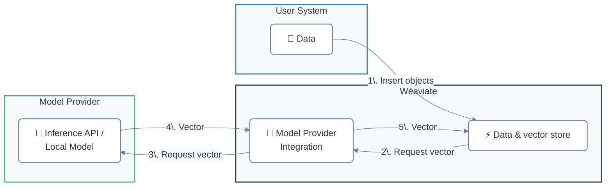

Weaviate integrates with a variety of [self-hosted](#locally-hosted) and [API-based](#api-based) models from a range of providers.

This enables an enhanced developed experience, such as the ability to:

- Import objects directly into Weaviate without having to manually specify embeddings, and
- Build an integrated retrieval augmented generation (RAG) pipeline with generative AI models.

## Model provider integrations

### API-based

| Model provider | Embeddings | Generative AI | Others |
| --- | --- | --- | --- |
| [Anthropic](./anthropic/index.md) | - | [Text](./anthropic/generative.md) | - |
| [Anyscale](./anyscale/index.md) | - | [Text](./anyscale/generative.md) | - |
| [AWS](./aws/index.md) | [Text](./aws/embeddings.md) | [Text](./aws/generative.md) | - |
| [Cohere](./cohere/index.md) | [Text](./cohere/embeddings.md), [Multimodal](./cohere/embeddings-multimodal.md) | [Text](./cohere/generative.md) | [Reranker](./cohere/reranker.md) |
| [Contextual AI](./contextualai/index.md) | - | [Text](./contextualai/generative.md) | [Reranker](./contextualai/reranker.md) |
| [Databricks](./databricks/index.md) | [Text](./databricks/embeddings.md) | [Text](./databricks/generative.md) | - |
| [DeepSeek](./deepseek/index.md) | - | [Text](./deepseek/generative.md) | - |
| [DigitalOcean](./digitalocean/index.md) | [Text](./digitalocean/embeddings.md) | [Text](./digitalocean/generative.md) | - |
| [FriendliAI](./friendliai/index.md) | - | [Text](./friendliai/generative.md) | - |
| [Google](./google/index.md) | [Text](./google/embeddings.md), [Multimodal](./google/embeddings-multimodal.md) | [Text](./google/generative.md) | - |
| [Hugging Face](./huggingface/index.md) | [Text](./huggingface/embeddings.md) | - | - |
| [Jina AI](./jinaai/index.md) | [Text](./jinaai/embeddings.md), [Multimodal](./jinaai/embeddings-multimodal.md) | - | [Reranker](./jinaai/reranker.md) |
| [Meta](./meta/index.md) | - | [Text](./meta/generative.md) | - |
| [Mistral](./mistral/index.md) | [Text](./mistral/embeddings.md) | [Text](./mistral/generative.md) | - |
| [Morph](./morph/index.md) | [Text](./morph/embeddings.md) | - | - |
| [NVIDIA](./nvidia/index.md) | [Text](./nvidia/embeddings.md), [Multimodal](./nvidia/embeddings-multimodal.md) | [Text](./nvidia/generative.md) | [Reranker](./nvidia/reranker.md) |
| [OpenAI](./openai/index.md) | [Text](./openai/embeddings.md) | [Text](./openai/generative.md) | - |
| [Azure OpenAI](./openai-azure/index.md) | [Text](./openai-azure/embeddings.md) | [Text](./openai-azure/generative.md) | - |
| [TwelveLabs](./twelvelabs/index.md) | [Multimodal](./twelvelabs/embeddings-multimodal.md) | - | - |
| [Voyage AI](./voyageai/index.md) | [Text](./voyageai/embeddings.md), [Multimodal](./voyageai/embeddings-multimodal.md) | - | [Reranker](./voyageai/reranker.md) |
| [Weaviate](./weaviate/index.md) | [Text](./weaviate/embeddings.md), [Multimodal](./weaviate/embeddings-multimodal.md) | - | - |
| [xAI](./xai/index.md) | - | [Text](./xai/generative.md) | - |

#### Enable all API-based modules

All API-based model integrations are available by default starting with Weaviate `v1.33`.

To opt out, for example in an air-gapped or otherwise restricted deployment, set the [`API_BASED_MODULES_DISABLED` environment variable](/deploy/configuration/env-vars#API_BASED_MODULES_DISABLED) to `true`. Weaviate then loads only the modules that you list in [`ENABLE_MODULES`](/deploy/configuration/env-vars#ENABLE_MODULES). This variable was added in `v1.33`.

For releases before `v1.33`, enable all API-based modules by setting the [`ENABLE_API_BASED_MODULES` environment variable](/deploy/configuration/env-vars#ENABLE_API_BASED_MODULES) to `true`. Weaviate stopped reading that variable in `v1.33`.

### Locally hosted

| Model provider                             | Embeddings                                                                                         | Generative AI                  | Others                                 |
| ------------------------------------------ | -------------------------------------------------------------------------------------------------- | ------------------------------ | -------------------------------------- |
| [GPT4All (Deprecated)](./gpt4all/index.md) | [Text (Deprecated)](./gpt4all/embeddings.md)                                                       | -                              | -                                      |
| [Hugging Face](./transformers/index.md)    | [Text](./transformers/embeddings.md), [Multimodal (CLIP)](./transformers/embeddings-multimodal.md) | -                              | [Reranker](./transformers/reranker.md) |
| [KubeAI](./kubeai/index.md)                | [Text](./kubeai/embeddings.md)                                                                     | -                              | -                                      |
| [Model2vec](./model2vec/index.md)          | [Text](./model2vec/embeddings.md)                                                                  | -                              | -                                      |
| [Meta ImageBind](./imagebind/index.md)     | [Multimodal](./imagebind/embeddings-multimodal.md)                                                 | -                              | -                                      |
| [Ollama](./ollama/index.md)                | [Text](./ollama/embeddings.md)                                                                     | [Text](./ollama/generative.md) | -                                      |

import AcademyAdmonition from '@site/src/components/AcademyAdmonition';

<AcademyAdmonition
  courseId="embedding-model-evaluation"
/>

## How does Weaviate generate embeddings?

Weaviate generates a vector only when the collection selects a model integration as the vectorizer for that target: the default vector, or a named vector. Enabling an integration on the server adds the capability, but it does not set a vectorizer on any collection, and there is no instance-wide default vectorizer. A vector that you supply for a target is kept. A target whose vectorizer is `none` stores an object that arrives without a vector, and vector search on that target does not return the object.

For a text vectorizer, Weaviate composes the input text from the object, sends it to the integration provider, and stores the returned vector with the object.

Weaviate generates embeddings for objects as follows:

- Selects properties with `text` or `text[]` data types unless they are configured to be skipped
- Sorts properties in alphabetical (a-z) order before concatenating values
- Prepends the collection name if configured

:::note Case sensitivity
For Weaviate versions before `v1.27`, the string created above is lowercased before being sent to the model provider. Starting in `v1.27`, the string is sent as is.

If you prefer the text to be lowercased, you can do so by setting the `LOWERCASE_VECTORIZATION_INPUT` environment variable.
The text is always lowercased for the `text2vec-contextionary` integration.
:::

## Choosing and evaluating an embedding setup

This guidance applies to text vectorizers. Multimodal and multi-vector integrations build other inputs, so check the integration page.

### Choose a vectorization route

Use an integrated [vectorizer](/weaviate/manage-collections/vector-config#specify-a-vectorizer) when all of these conditions hold:

- The object text contains the passage that should match a query.
- The integration offers an encoder for your data type and language.
- Sending that text to the provider, or running the model in your own cluster with a [locally hosted integration](#locally-hosted), meets your data-handling requirements.
- The provider's charges and rate limits fit your import and query volume.

Provide the vectors yourself when any of these conditions holds:

- Another system already produces the vectors, or must use the same vectors.
- You need an encoder or an input format that no integration provides.
- You need an encoded input that the integration cannot produce, for example a custom prefix or a field order that differs from the integration's composition.

A supplied vector is not private by itself: text that you sent to an external embedding service has already left your infrastructure. Where the model runs, and what the provider keeps, decide the data flow, so check the provider's terms before you send production text.

You can do both, per target. Weaviate keeps a vector that you supply for a target and generates a vector only for an object that arrives without one for that target. Each target has its own vector index, so a collection can combine generated and supplied targets; within a target, use compatible encoders.

### Keep document and query vectors compatible

The stored vectors and the query vectors must be compatible for the same intended vector space. Compatibility comes from the encoders and their settings, not from a vendor name, a model name or a matching dimension count. Record these for each target:

- **Encoder and version.** A new model version, a different preprocessing step or a different fine-tune can produce a different space. The same model name from two providers is not proof of compatibility; check the provider's model, version and normalization.
- **Output dimensions.** If the integration has a `dimensions` setting, use the same value for every vector in that target. If you call the provider yourself, match its output-dimension setting.
- **Document and query modes.** Many retrieval models take a stored document and a query in different modes. For example, the Cohere integration encodes imported text with `search_document` and query text with `search_query`. When you supply vectors, encode the stored text in the model's document mode and the query text in its query mode. Check the model's documentation: Voyage AI states that embeddings generated with and without its `input_type` argument are compatible, and it recommends that you set the argument. A jointly trained multimodal model can pair different encoders for text and images.
- **Indexed input.** For a text vectorizer, Weaviate builds one string from the object: the included properties in alphabetical order, joined with spaces, plus the property names and the collection name if the configuration adds them. See [the rules above](#how-does-weaviate-generate-embeddings). If you mix supplied and generated vectors in one target, or you want the same vectors as the integration, build the string the same way. A target that holds only vectors you supply can use another input construction, as long as your query vectors use the same encoder and the same convention. `source_properties` selects the properties; it does not set their order.

Weaviate checks the vector length and shape, not the encoder. A vector whose length differs from the vectors already in the index is rejected. A vector from an unrelated encoder that has the same number of dimensions is accepted without an error, so incompatible vectors can return unrelated results and nothing reports the problem. These rules apply per target, because each target has its own index and its own space.

### Keep the input within the model limit

A text vectorizer sends one input per object per target and does not split long text. A long document stored as one object is therefore one vector, and it does not create independently searchable passages.

If the input is longer than the model accepts, the outcome depends on the integration. Cohere discards the end of the input by default (`truncate: "END"`), and Voyage AI truncates by default (`truncate: true`). Other integrations have their own input limit and truncation behaviour, so check the model's limit and the integration's parameters.

Choose the retrieval unit before you embed. To find a passage inside a document, store passages as separate objects. A chunk is a separate object with its own vector and storage cost, and an integration or your own code can embed it, so chunking does not by itself require caller-provided vectors. Setting truncation to fail detects input that would be cut, but it does not make a long document searchable: split or shorten the input, then import again.

### Evaluate a change on your own queries

1. Collect queries that you did not use while designing the schema and the chunks, and the objects that a person judges relevant. Fix the corpus and the relevance unit for a model comparison: if you change chunk boundaries, relabel, or map the labels to the source document. State the quality floor that a valid result must meet, and the latency, cost and data-handling limits.
2. Run each configuration on the same queries with the same `limit`, distance metric and filters. For the model comparison, use a [flat index](/weaviate/config-refs/indexing/vector-index.mdx#flat-index) with no quantizer: set `skipDefaultQuantization: true` (`Configure.VectorIndex.Quantizer.none()` in the Python client) and configure neither `bq` nor `rq`. A flat index without a quantizer compares every vector, so the ranking comes from the encoder and not from an approximate search. If the representation cannot use a flat index, treat the comparison as approximate and change one search setting at a time.
3. Record two measures:
   - Success at k: the share of queries with at least one relevant result in the top k results.
   - nDCG at k: how close to the top the relevant results appear.
4. When a query fails, check the likely causes before you change the encoder:
   - Confirm that the relevant text was in the indexed input. If truncation cut it, change the chunk or the input length.
   - Remove the filter and repeat the query. If the object then appears, investigate the filter before you change the encoder: check that the object matches the predicate and that the filtered property is indexed, because removing a filter changes eligibility and the search plan. To separate a filter effect from approximation, repeat both queries on the flat-index reference collection. See the [vector index settings](/weaviate/config-refs/indexing/vector-index.mdx).
   - If the object is returned but ranks below unrelated objects, compare several labeled queries before you change anything. The query mode, the input text or the chunk can cause it as well as the encoder.
5. Compare each configuration against the quality floor and the constraints, and inspect the important regressions. Do not require every measure to improve: a cheaper or faster configuration that still meets the floor is a valid choice.

Published benchmark results are a coarse prior. [MTEB](https://arxiv.org/abs/2210.07316) finds that "no particular text embedding method dominates across all tasks", and [BEIR](https://arxiv.org/abs/2104.08663) reports that dense retrieval models often underperform when they are applied to new domains. Neither predicts your data.

Change the representation and the search separately. The encoder, the input text and the chunk size change the vectors; `ef`, quantization and compression change the search over those vectors. Test the two groups apart. To move an existing collection to another model, see [Switching vectorizers](/weaviate/tutorials/vectorizer-migration).

## Rate limits for API-based embeddings

Model providers throttle how fast you can call them, so a large import often ends in `429` errors. To keep Weaviate inside your quota, tell it what the quota is with two request headers:

- `X-<Provider>-Ratelimit-RequestPM-Embedding`: the requests-per-minute limit
- `X-<Provider>-Ratelimit-TokenPM-Embedding`: the tokens-per-minute limit

`<Provider>` is the same name as in the API key header on the integration's page. A collection vectorized by Cohere, for example, takes `X-Cohere-Ratelimit-RequestPM-Embedding` next to `X-Cohere-Api-Key`. Set the headers when you connect, so every batch request carries them.

The values must be whole numbers. Weaviate falls back to the integration's own default if a header is missing or cannot be parsed.

The headers are read by the Cohere, Databricks, DigitalOcean, Jina AI, Mistral, OpenAI, Azure OpenAI, Voyage AI, and Weaviate Embeddings integrations. Other integrations ignore them.

## Troubleshooting: a missing or misconfigured API key

Credential sources, prerequisites and error messages differ by integration. For example, Cohere reads `X-Cohere-Api-Key` or `COHERE_APIKEY`, and a key in the header takes precedence; AWS reads `X-Aws-Access-Key` and `X-Aws-Secret-Key`, or `AWS_*` environment variables; and Google on Vertex AI with Google authentication uses Application Default Credentials instead of an API key.

Use the credential method that the integration's page documents. Keep credentials out of the collection configuration: Weaviate does not read them there. Read the credential section of your integration's page for the exact names and prerequisites.

## Questions and feedback

import DocsFeedback from '/\_includes/docs-feedback.mdx';

<DocsFeedback/>
